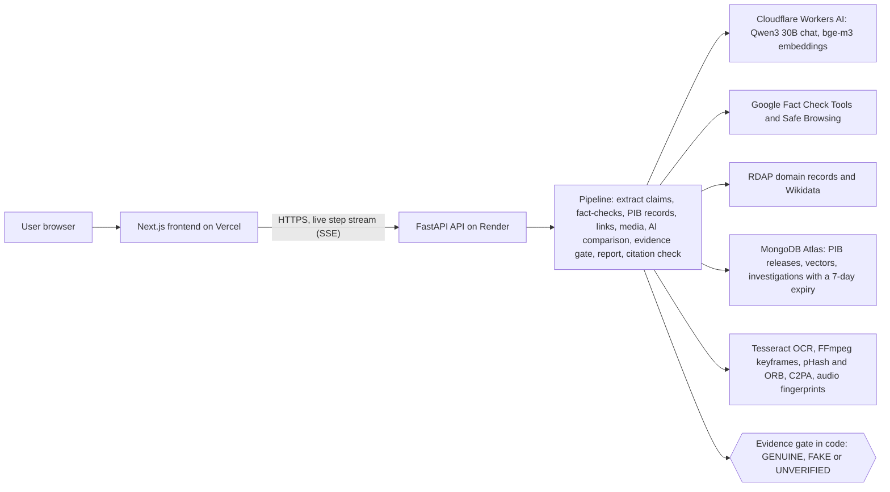

# Satyapan 2.0

**Evidence-gated verification and media provenance audit for government-related messages in English, Hindi and Telugu.**

- **Live app:** https://satyapan-beige.vercel.app
- **API status:** https://satyapan-api.onrender.com/v1/status

The API runs on a free server that sleeps when idle. If the first check takes about a minute, the server was waking up.

Paste a forwarded message, a link, a screenshot, a photo, a video or an audio clip. Satyapan extracts the claims, searches published fact-checks and official PIB releases, checks every link, audits the media for reuse and Content Credentials, and returns **GENUINE**, **FAKE** or **UNVERIFIED**. Each verdict comes with quoted, linked and timestamped evidence. The web app shows every step live as it runs.

**Code decides the verdict.** The hosted AI model (Cloudflare Workers AI on its free plan by default, or any other hosted provider you configure) extracts claims, compares claims with retrieved evidence and writes an explanation. Code checks every quote and citation it produces. The model can block a GENUINE verdict but never sets one.

Satyapan is **not a deepfake detector**. It reports media reuse, credentials and provenance, and says so on every report.

## What decides each verdict

| Verdict | Needs |
|---|---|
| GENUINE | A specific official release with matching facts. Either every word of the release title is in the message (no added negation), or the message links that exact release (PIB `PRID`) and an AI comparison found the same facts with quotes verified in code, and every number and date matches. Not when the PIB link points to a different release, not when old news is presented as new, not when the AI comparison contradicts it |
| FAKE | Reliable contradicting evidence: a fact-check rated false that matches the claim (lexically, or semantically with a verified AI match and no conflicting numbers or dates), a Safe Browsing flag, an impersonating domain, or an exact or modified copy of a debunked image |
| UNVERIFIED | Everything else, with a reason: not enough evidence, conflicting evidence, outdated news, link mismatch, AI veto, or tools unavailable |

Embedding similarity alone never produces a verdict. A similar-looking photo is never evidence of fake.

## Architecture



The AI steps (claim extraction, evidence comparison, explanation) only propose. Code checks every quote against the source text and decides the verdict from cited evidence. More detail: `docs/ARCHITECTURE.md`.

## Run it locally

Backend (Python 3.12, FFmpeg and Tesseract with `eng`, `hin` and `tel`):

```bash
python3 -m venv .venv
.venv/bin/pip install -r requirements-dev.txt
cp .env.example .env                       # then fill in what you have (Option A, Cloudflare Workers AI, is free)
.venv/bin/python -m uvicorn satyapan.api.app:app --port 8000
```

Frontend (Node 22):

```bash
cd frontend
npm ci
NEXT_PUBLIC_API_BASE_URL=http://localhost:8000 npm run dev      # http://localhost:3000
```

Without keys everything still runs: the tools that need a key report `AUTH_REQUIRED` and the verdict falls back to what the other evidence supports.

Load real official data (PIB refuses scripts, so save the feed from a browser first):

```bash
.venv/bin/python scripts/ingest_pib.py --from-file ~/Downloads/pib_en.xml ~/Downloads/pib_hi.xml
.venv/bin/python scripts/ingest_pib.py --set-date --prid 2100005 --published 2026-10-30   # date from the release page
.venv/bin/python scripts/import_known_debunks.py my_debunks.csv                            # real fact-checks with links
.venv/bin/python scripts/embed_corpus.py                                                   # once, after imports
```

## Tests

```bash
.venv/bin/python -m pytest                     # offline unit and rule tests, no keys needed
.venv/bin/python -m integration.run_all --allow-third-party    # LIVE calls to every configured service
.venv/bin/python audit/adversarial_verdicts.py && .venv/bin/python audit/llm_injection.py
cd frontend && npm test && npm run build && npm run check-bundle
```

Offline tests use clearly labelled fixtures and mocked services. They check the rules, not accuracy. Accuracy is measured only with `eval/` on a labelled dataset of real records (see `docs/EVALUATION.md`).

## Deployment (as submitted)

| Part | Where | Notes |
|---|---|---|
| Frontend | Vercel (Hobby), root folder `frontend` | `NEXT_PUBLIC_API_BASE_URL` points to the API. No secrets |
| API | Render (Free web service), built from this `Dockerfile` | Secrets are Render environment variables: `CLOUDFLARE_ACCOUNT_ID`, `CLOUDFLARE_API_TOKEN`, `GOOGLE_API_KEY`, `MONGODB_URI`. Settings: `AI_CHAT_PROVIDER=cloudflare`, `AI_EMBEDDING_PROVIDER=cloudflare`, `MONGODB_DB=satyapan`, `PORT=8080`, `SATYAPAN_MAX_CONCURRENT_JOBS=1`, `SATYAPAN_TRUSTED_PROXY_HOPS=1`, `SATYAPAN_ALLOWED_ORIGINS=<frontend URL>` |
| Database | MongoDB Atlas M0 (free), AWS Mumbai | Loaded with `scripts/init_db.py`, `scripts/ingest_pib.py --copy-local-to-mongo`, `scripts/embed_corpus.py` |
| AI | Cloudflare Workers AI, free plan | See `docs/CLOUDFLARE.md` |

Check a deployment with `python deploy/smoke_test.py --api <API URL> --origin <frontend URL> --check-rate-limit`.

**Live results, 1 Nov 2026** (deployed app, real services):

| Check | Result |
|---|---|
| Smoke test | 10/10: live step stream, private records, report download, CORS, rate limit with a spoofed `X-Forwarded-For` |
| Exact title and link of a real PIB release (PRID 2331041) | GENUINE |
| Hindi free-laptop forward with a `.top` link | UNVERIFIED (two weak signals, nothing strong) |
| PM-Kisan message linking `pmkisan.gov.in.ekyc-update.top` | FAKE |
| Google's Safe Browsing test page | FAKE |

Four examples show the system works end to end. They are not an accuracy measurement.

Google Cloud Run is an alternative host: see `docs/DEPLOYMENT.md`.

## Documents

| File | Contents |
|---|---|
| `docs/ARCHITECTURE.md` | Components, data flow, evidence gate |
| `docs/API_CONTRACT.md` | Endpoints, events and report fields |
| `docs/DEPLOYMENT.md` | Cloud Run, Atlas, secrets, limits, costs |
| `docs/SECURITY.md` | Threat model and controls |
| `docs/EVALUATION.md` | Dataset rules and metrics |
| `docs/LIMITATIONS.md` | What Satyapan cannot do |
| `docs/IMPLEMENTATION_LOG.md` | What changed in 2.0, commands run, test results |
| `docs/AI_USAGE_DISCLOSURE.md` | How AI coding assistance was used (draft for the team) |
| `docs/FEASIBILITY_README.md` | The 30 to 31 Oct 2026 feasibility prototype this version builds on |

## Origin of this code

Satyapan 2.0 builds on a feasibility prototype written on 30 and 31 October 2026, largely with an AI coding assistant, and tested by the team on a MacBook. Both facts are recorded in `docs/FEASIBILITY_README.md`, `docs/IMPLEMENTATION_LOG.md` and `docs/AI_USAGE_DISCLOSURE.md` so they can be disclosed to the organisers as their rules require.
